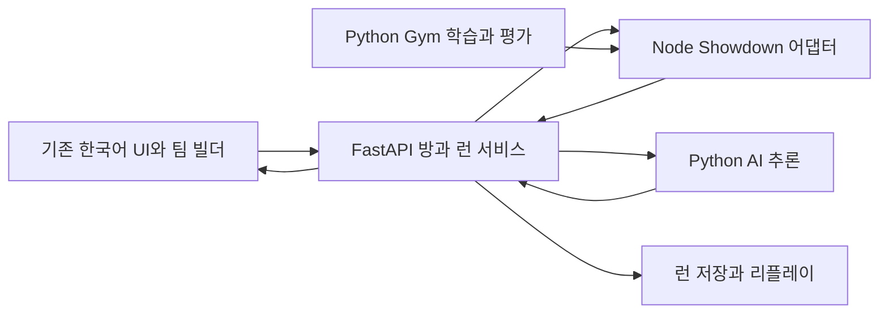

# 포켓몬 배틀 AI 로그라이크 개발 계획

작성일은 2026년 10월 26일이며, 현재 저장소 기준 커밋은 `724f0fdc67468c9ed1f294f431133112d884a15d`이다. 개발 방향은 사용자가 선택한 배틀·AI·로그라이크 중심 확장이다. 기존 한국어 화면, 팀 빌더, 추천 팀과 콘텐츠 허브를 유지하고 전투 판정과 학습 환경을 하나의 엔진으로 통합한다. 첫 출시 목표는 짧은 런을 시작부터 보스전과 결과 화면까지 완주하고 저장 후 재개할 수 있는 버전이다.

## 레퍼런스 선정과 적용 범위

| 프로젝트 | 공식 근거 | 적용할 부분 | 적용 방법 |
| --- | --- | --- | --- |
| REA | [저장소](https://github.com/morluto/rea), [브라우저 관찰](https://github.com/morluto/rea/blob/main/docs/browser-observation.md), [시나리오 계약](https://github.com/morluto/rea/blob/main/docs/browser-scenario-contract.md) | 배포 화면과 입력 후 상태 변화의 증거, 재현 가능한 비교 시나리오 | 공개 소스는 직접 읽고, REA는 실행 동작 확인에 사용한다. |
| Pokémon Showdown | [저장소](https://github.com/smogon/pokemon-showdown), [Simulator API](https://github.com/smogon/pokemon-showdown/blob/master/sim/SIMULATOR.md), [팀 검증](https://github.com/smogon/pokemon-showdown/blob/master/sim/TEAMS.md) | 전투 규칙, 서버 판정, 합법 행동, 팀 검증, 리플레이 | `BattleStream`을 Node 서비스로 감싸는 방식을 먼저 검증한다. |
| PokéRogue | [저장소](https://github.com/pagefaultgames/pokerogue), [모드](https://github.com/pagefaultgames/pokerogue/blob/main/src/game-mode.ts), [저장](https://github.com/pagefaultgames/pokerogue/blob/main/src/system/game-data.ts) | 전투 사이 보상, 지역 분기, 보스 예고, 런과 영구 해금의 분리 | 현재 3대3 게임에 맞춰 규모를 줄이고 흐름을 독립 구현한다. |
| poke-env | [저장소](https://github.com/hsahovic/poke-env), [강화학습 예제](https://github.com/hsahovic/poke-env/blob/master/examples/reinforcement_learning.py), [행동 공간](https://github.com/hsahovic/poke-env/blob/master/src/poke_env/environment/singles_env.py) | 관측, 합법 행동 마스크, 기준 상대, 자기 대전과 평가 | 설계와 벤치마크를 참고한다. 전용 BattleStream 서비스와의 연결은 직접 Gym 어댑터로 구현한다. |

Showdown과 poke-env는 각각 [MIT](https://github.com/smogon/pokemon-showdown/blob/master/LICENSE), [MIT](https://github.com/hsahovic/poke-env/blob/master/LICENSE) 라이선스를 명시한다. PokéRogue의 소스는 기본 AGPL-v3.0-only이며 문서와 적용 가능한 자산의 조건은 다르다. 현재 계획은 PokéRogue의 진행 구조를 참고해 독립 구현하는 방식이다. 코드를 도입할 경우 파일별 조건을 다시 확인하고, 스프라이트·음악·로고의 출처와 사용 조건은 별도로 기록한다. [PokéRogue 라이선스 설명](https://github.com/pagefaultgames/pokerogue#licensing)

보조 참고 대상은 [Pokémon Auto Chess](https://github.com/keldaanCommunity/pokemonAutoChess)의 라운드·보상 데이터와 파티 시너지다. 자동전투 방식은 현재 턴제 게임에 도입하지 않는다. 필드 탐험용 엔진과 다른 팬게임 전체 이전은 초기 범위에 포함하지 않는다.

## REA 조사와 비교 방식

이번 REA 관찰은 PokéRogue 배포 페이지를 임시 브라우저로 열고 Canvas가 나타나는 단계까지 확인했다. Canvas의 전투·보상 내용은 접근성 트리에서 읽히지 않아 이후 비교는 화면과 입력을 함께 기록해야 한다. 전체 런을 플레이한 관찰로 해석하지 않는다.

- 대상: `https://pokerogue.net/`
- 관찰: `capture_browser_scenario`, Canvas 표시 대기와 2초의 추가 대기.
- 증거: [pokerogue-loading-evidence.json](research/rea/pokerogue-loading-evidence.json)
- Evidence ID: `ev_400fafe00ed111ac161f2de6cdc6e44f33415b8bae38011d9da3e26819ecbd5f`
- 결과: 요청한 단계 완료, DOM과 접근성 캡처 보관, 임시 브라우저 종료 확인.

실제 개발에 앞서 다음 범위의 레퍼런스 동작을 관찰한다. 소스 버전과 배포 버전은 따로 기록하며 일치한다고 가정하지 않는다. 개발용 로컬 실행본에는 저장 데이터가 없는 전용 프로필을 사용한다.

| 시나리오 | 관찰할 내용 | 우리 게임의 산출물 |
| --- | --- | --- |
| 시작 파티 선택 | 선택 제한, 파티 요약, 시작까지 필요한 입력 | 초보자가 추천 팀으로 첫 전투를 시작하는 흐름 |
| 한 턴 진행 | 기술 입력, 행동 대기, 교체, 결과 표시 순서 | 서버 이벤트와 화면 표시의 대응표 |
| 전투 종료와 보상 | 보상 후보, 선택 조건, 재추첨, 다음 단계 이동 | 보상 상태 전이와 중복 수령 방지 기준 |
| 분기와 보스 예고 | 위험도와 예상 보상의 표시 | 다음 노드를 고르는 화면의 정보 우선순위 |
| 저장과 재개 | 저장 시점, 파티 자원과 현재 위치 복구 | 동일 런 복원 검사 |

관찰마다 대상 URL 또는 로컬 빌드 커밋, 입력 목록, 스크린샷, 실제로 관찰된 결과, 제한사항을 보관한다. REA의 관찰 결과를 기능 명세와 검증 사례에 연결한다. 네트워크 기록으로 환경을 만드는 REA 기능을 전투 시뮬레이터의 대체물로 취급하지 않는다.

## 첫 플레이 가능한 버전

초기 수치는 밸런스 검증을 위한 설계값이다. 참고 게임의 규칙을 그대로 옮긴 수치가 아니다.

- 9세대 규칙을 기준으로 한 3대3 싱글, 레벨 50 고정. 최초에는 세대별 특수 기믹을 비활성화한다.
- 밸런스 검증용 포켓몬 약 30종과 사전 검증한 기술·특성·도구 조합으로 시작한다. 기존 전체 도감은 보존하고 모드별 사용 가능 풀을 나눈다.
- 한 런은 20개 진행 노드로 구성한다. 일반전, 정예전, 휴식, 상점과 보스전을 배치하고 일부 구간에 두 갈래 선택을 제공한다.
- 3마리로 시작하고 제한된 영입 기회에서 기존 멤버와 교체한다.
- 전투 승리 후 후보 3개 중 1개를 선택한다. 회복, PP 보충, 기술 변경, 도구, 런 전용 특전으로 구성한다.
- 런 전용 특전은 12종 안팎으로 시작하며 상점 할인, 보상 재추첨, 회복 효율처럼 런 단계에서 처리할 수 있는 효과를 우선한다.
- 적 팀 테마 6개, 보스 원형 3개를 준비한다. 보스의 차이는 팀 구성·기술·도구·AI 정책으로 먼저 표현한다.
- HP·PP·주요 상태이상과 소비한 도구를 전투 사이에 이월한다. 능력 랭크, 풀죽음, 도발 등의 전투 임시 상태는 새 전투에서 정리한다.
- 전투·보상·상점·휴식 사이의 안전한 경계에서 저장한다. 초기 버전의 재개는 마지막 저장 경계부터 지원한다.
- 영구 해금은 시작 파티 선택지, 기록, 도감 중심으로 만든다. 첫 버전은 능력치 영구 상승을 요구하지 않는다.

임의 능력치 배수와 중첩 전투 특전은 별도의 PvE 규칙 확장으로 후속 검토한다. PvP는 표준 규칙을 사용하고 런 특전을 받지 않는다.

## 권장 구조

브라우저는 선택 입력과 서버 이벤트 표시를 맡는다. 피해량·턴 순서·승패는 서버 엔진이 판정한다. FastAPI는 방, 접속, 런 진행, 저장과 권한을 관리하고, Node 어댑터는 Showdown과 데이터 변환을 맡는다. Python 학습도 같은 Node 어댑터를 사용한다.

Showdown 시뮬레이터는 팀 검증을 별도로 요구한다. `TeamValidator`와 모드별 허용 풀을 통과한 팀으로 능력치를 서버에서 재구성한다. 상대에게는 공개된 상태와 이벤트만 전달하고, 미공개 기술·도구·정확한 HP 등의 내부 정보를 구분한다. [팀 검증 API](https://github.com/smogon/pokemon-showdown/blob/master/sim/TEAMS.md), [전투 스트림](https://github.com/smogon/pokemon-showdown/blob/master/sim/SIMULATOR.md)

poke-env는 Showdown 웹소켓 서버와 통신하므로 전용 BattleStream 서비스에 바로 연결되지 않는다. 주 구조는 직접 Gym 어댑터를 사용한다. poke-env 자체를 사용할 필요가 생기면 같은 버전의 로컬 Showdown 서버를 별도 평가 경로로 운영하거나, 전체 서버를 공통 연결 지점으로 쓰는 구조를 다시 선택한다.

| 책임 | 제안 위치 | 기존 코드와의 관계 |
| --- | --- | --- |
| 게임 화면 | `pokemon_rl/web/` | 기존 HTML에서 화면·스타일·데이터를 단계적으로 분리 |
| 전투 엔진 어댑터 | `pokemon_rl/battle_service/` | 기존 JS와 Python의 피해·턴 판정을 대체 |
| 공통 서버 로직 | `pokemon_rl/services/` | `server_core.py`와 `server_deploy.py`가 같은 서비스 사용 |
| 런과 콘텐츠 | `pokemon_rl/content/`, `pokemon_rl/services/run_service.py` | 현재 campaign 함수와 테마 팀 생성기를 이관 |
| 학습 연결 | `pokemon_rl/training/` | 현재 환경·PPO의 관측과 행동 정의를 명시적으로 교체 |
| 검증 사례 | `pokemon_rl/tests/`, `pokemon_rl/replays/` | 기존 버그 재현과 엔진·UI·AI 계약 확인 |

위 경로는 구현 시 만들 위치이며 이번 계획 작업에서 게임 코드는 이동하지 않았다.

## 상태와 프로토콜 계약

`BattleEngine`은 팀 검증, 배틀 생성, 플레이어별 관측·합법 행동 조회, 행동 제출, 이벤트 읽기, 종료 상태 조회를 제공한다. 내부 API를 여러 파일에서 직접 호출하지 않고 이 경계에 모은다.

- 클라이언트 명령: `battleId`, 서버 세션에 연결된 플레이어, `requestId`, 행동 종류와 슬롯. 클라이언트가 보낸 능력치와 승패는 수락하지 않는다.
- 서버 이벤트: 증가하는 이벤트 번호, 고정된 `player1/player2` 식별자, 해당 플레이어의 공개 상태와 로그. 재전송과 중복 입력을 구분한다.
- 리플레이: 엔진 커밋, 규칙·포맷 버전, 검증된 팀, 시작 HP·PP·상태·소비 도구를 담은 초기 복원 데이터, 적용한 런 특전, seed와 승인된 입력 목록. 두 번째 PvE 경기부터도 같은 시작 상태를 재현하고 이벤트의 결정적인 투영으로 결과를 비교한다.
- 난수: 전투, 노드 생성, 보상에 별도 난수 흐름을 사용한다. 보상 재추첨이 다른 전투의 난수를 바꾸지 않게 한다.
- `RunState`: 저장 형식 버전, 런 ID, seed·난수 상태, 현재 노드, 파티별 종·폼·기술 ID·특성·성격·EV·IV·레벨과 HP·PP·상태·도구, 재화·특전, 진행 단계, 이미 처리한 보상 ID, 콘텐츠·규칙 버전. 기술 변경과 영입 이후에도 파티 구성을 복원할 수 있어야 한다.
- `ProfileState`: 도감, 시작 파티 해금, 최고 기록과 설정. 진행 중인 런과 따로 저장한다.
- PvP 상태는 서버가 보관하고 재접속 시 해당 플레이어의 최신 상태를 다시 제공한다.

전투 사이 자원 이월은 엔진 도입의 핵심 검증 항목이다. 문서화된 API로 가능한 범위를 확인하고, 추가 모드나 초기 상태 복원이 필요하면 버전을 고정한 어댑터 안에서 구현한다. 전투 후 외부 코드로 임의 피해를 적용하는 식으로 판정 경계를 나누지 않는다.

## 개발 단계와 완료 기준

기간은 1인 집중 개발을 가정한 초기 추정이다. 전체 8~12주를 출발점으로 삼되, 2단계의 자원 이월과 배포 검증 결과에 따라 다시 산정한다. AI 학습 계산 시간과 새로운 그림·음악 제작은 별도다.

| 단계 | 예상 기간 | 작업과 산출물 | 다음 단계로 넘어가는 기준 |
| --- | --- | --- | --- |
| 0 레퍼런스 명세 | 2~3일 | REA 시나리오, 라이선스·소스 버전 목록, 현재 기능 대응표 | 채택할 동작마다 현재 코드의 변경 지점과 검증 사례가 연결됨 |
| 1 기존 버전 안정화 | 3~5일 | XSS 제거, 입력 타입·길이 검증, 이탈한 방 상태 정리, KO·교체 사례 | 악성 방 이름은 텍스트로 보이고, 재입장 가능하며 HP 0 선두가 행동하지 않음 |
| 2 엔진 연결 검증 | 4~7일 | Node BattleStream 어댑터, 팀 ID 변환, TeamValidator, 프로세스 소유권과 통신 방식, 3대3 한 경기와 다음 경기 연결 | 전투·자원 이월·저장 복원 통과, 실제 배포 환경에서 worker 시작·통신·종료·재시작 확인 |
| 3 판정 통합 | 1~2주 | 공통 서버 서비스, UI 이벤트 표시, 직접 Gym 어댑터, 리플레이 | 같은 팀·seed·입력은 같은 결과, 양쪽 공개 상태 일치, 불법 행동 거부 |
| 4 로그라이크 완주 | 약 2주 | 20노드 런, 3택1 보상, 상점·휴식·영입·보스, RunState 저장 | 시작부터 결과 화면까지 완주하고 경계 저장에서 복구, 보상 중복 수령 불가 |
| 5 AI 학습과 평가 | 1~2주 | 규칙 AI, 관측·행동 계약, 마스크를 보존한 PPO, 실제 상대 모델을 쓰는 자기 대전 | 불법 행동 0, 학습·실전 규칙 일치, 고정 평가 세트의 결과와 처리시간 기록 |
| 6 배포와 밸런스 | 약 1주 | 두 브라우저 대전, 재접속, 설정 반영, 콘텐츠·저장 버전 관리, 설치 안내 | 런 완주·재개·멀티 재접속 검사와 목표 장치 성능 측정 통과 |

0단계와 1단계는 병행할 수 있다. 4단계와 5단계는 3단계의 엔진 계약이 안정된 뒤 병행할 수 있다. 2단계 통과 전에는 현재 엔진을 제거하거나 전체 화면을 새 프레임워크로 재작성하지 않는다.

2단계에서는 FastAPI가 Node worker를 자식 프로세스로 소유하고 줄 단위 JSON으로 통신하는 안을 우선 검증한다. 배포 제약에 따라 별도 내부 서비스로 바꿀 경우 연결 수명과 재시작 책임을 명시한다. 내부 전투 서비스는 외부에 직접 노출하지 않고, worker 장애 시 처리 중인 입력의 승인 여부를 구분하여 중복 실행을 막는다. 전투 검사에는 강제 교체, 날씨 KO, 특성, 도구와 자원 이월을 포함한다.

Showdown 연결이 자원 이월이나 배포 요구를 충족하지 못하면 기존 JavaScript 전투 엔진을 화면 없는 모듈로 추출해 서버와 Python에서 함께 호출하는 대안을 검토한다. 이 경우에도 전투 규칙은 한 벌로 유지한다.

## 현재 결함을 처리하는 위치

| 현재 문제 | 처리 단계와 방법 |
| --- | --- |
| 방 이름·닉네임의 HTML 삽입 | 1단계에서 텍스트 렌더링과 서버 입력 검증 |
| 이탈한 팀 데이터와 유령 방 | 1단계에서 players·teams·entries·turn_actions를 함께 정리 |
| 날씨·트랩 KO와 교체 랭크 | 1단계에서 재현 사례 고정, 2~3단계에서 통합 엔진으로 검증 |
| 독립 난수·동속 선공·임의 종료 전파 | 3단계에서 서버 판정과 고정 플레이어 ID로 교체 |
| 더블배틀 선택과 실제 구현의 차이 | 첫 버전은 싱글만 표시하고 더블은 별도 후속 기능으로 관리 |
| 속도·애니메이션·상성 힌트 설정 미반영 | 3·6단계에서 렌더러와 대기시간에 연결 |
| 학습 환경의 특성·도구 누락과 상대 관점 오류 | 3·5단계에서 공통 엔진과 플레이어별 관측으로 교체 |
| PPO 업데이트의 행동 마스크 누락 | 5단계에서 마스크를 rollout에 저장하고 재평가에도 적용 |
| 별도 자기 대전 루프가 상대 모델을 사용하지 않음 | 5단계에서 실제 양쪽 모델의 행동 출처를 기록해 확인 |
| Python 모델과 HTML 모델 및 변환기의 불일치 | 우선 서버 추론을 사용하고 관측·행동 버전을 기록하여 재학습 |

현재 campaign은 승리 후 포켓몬을 재생성하고 HP만 복사하며, 진행 저장은 최고 기록·배지 중심이다. PP와 상태의 이월, 진행 중인 런의 재개는 새로 구현해야 한다. 현재 코드 위치는 `pokemon_battle_v3.html`의 `onCampaignBattleWon`과 `saveCampaignProgress`다.

## AI의 검증 기준

강한 규칙 AI를 먼저 제공하고 그 결과를 학습 모델의 기준선으로 사용한다. 관측은 자신의 기술·타입·위력·PP와 파티, 공개된 상대 정보, 날씨와 필드 상태를 포함한다. 관측·행동·규칙 버전이 바뀌면 기존 가중치가 호환된다고 가정하지 않는다.

1. 같은 가중치에서 수집 확률과 재평가 확률이 같은 마스크로 계산되어 확률비가 1에 가까운지 확인한다.
2. 각 플레이어는 자기 관점의 관측을 받으며 상대의 미공개 기술·도구를 알지 못하게 한다.
3. 랜덤, 높은 위력 우선, 규칙 AI와 이전 모델을 기준 상대에 포함한다. 최종 평가 팀과 seed는 학습용에서 분리한다.
4. 기준 상대별 500경기 이상을 초기 평가 예산으로 잡고 승률·무승부율·불법 행동률·평균 턴·추론 지연과 신뢰구간을 기록한다.
5. 승률 목표는 기준선을 측정한 뒤 정한다. 쉬운 상대에게만 강한 모델을 전반적인 개선으로 취급하지 않는다.
6. 브라우저 추론이 필요해질 때 전체 모델 변환기를 만들고 고정 관측 집합에서 Python과 JavaScript의 logits·행동 마스크·선택이 일치하는지 검사한다.

## 첫 구현 작업 묶음

1. 현재 버전의 버그 재현과 전투 입력·출력 사례를 작은 fixture로 보관한다.
2. 방 목록과 입장 메시지의 HTML 삽입을 제거하고 이탈 상태 정리를 통합한다.
3. 한국어 표시명과 엔진의 종·기술·특성·도구 ID를 분리한 변환표를 만든다.
4. `BattleEngine` 계약과 Node 어댑터로 지정된 두 팀의 3대3 배틀을 실행한다.
5. HP·PP·상태·소비 도구를 다음 배틀에 이월하고 저장에서 복원한다.
6. 같은 입력 로그의 재생 결과, 부정 입력 거부, 상대 비공개 정보 보호를 검사한다.
7. 통과한 경우에만 UI와 학습 환경을 새 엔진으로 순차 전환한다.

이 묶음의 종료 산출물은 기존 화면에서 동작하는 한 경기, 다음 경기로 이어지는 자원 상태, 재현 가능한 리플레이와 엔진 채택 판단이다. 이후 로그라이크 보상과 콘텐츠를 붙인다.
